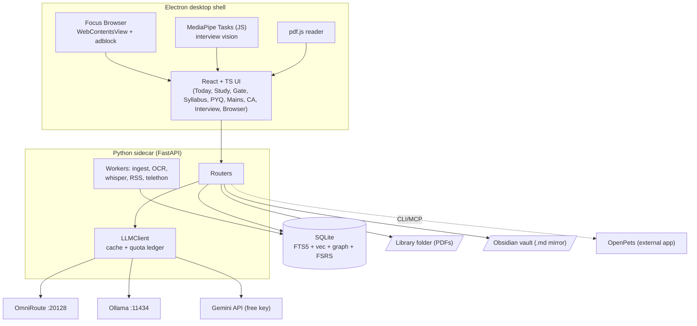

# UPSC JARVIS — Architecture

> Generated on 2026-11-01 | Momento: **validate** — pehle ek solo user (aap) ke liye core loop prove karna, phir features badhana.

## Summary
UPSC JARVIS ek **local-first desktop app** hai (Electron + React + TypeScript) jiske peeche **ek hi Python sidecar** (FastAPI) aur **ek SQLite file** hai. AI calls ek hi `LLMClient` se jaati hain, jo **OmniRoute** (free-tier gateway) aur **Ollama** (local model) ke upar baithta hai. Knowledge graph = **curated syllabus tree + links table**. Heavy tools (LightRAG, Postgres, browser-automation) *abhi nahi* hain, sirf measurable trigger par add honge.

> **Platform (owner ne bataya, 2026-11-01):** Windows laptop · Optional: **Sociology** · **English medium**. RAM/GPU abhi pata nahi (open).

## Dimension Extraction — 9/9 confident

```
📊 Dimension Extraction — 9/9 dimensions confident

  project_moment   █████████░ validate     (0.90) ✓  "ban jaaye without much manual interaction", "pehle idea evaluate"
  product_type     ██████████ desktop      (0.95) ✓  "App locally chal jaaye", integrated browser, always-on-top pet
  team_size        ██████████ 1            (0.95) ✓  "mujhe vibe coding aati hai, app banana nahi aata"
  user_scale       ████████░░ lt_1k        (0.80) ✓  personal study app (single user)
  monthly_budget   ██████████ free         (0.98) ✓  "Sirf free tools ka hi use karna hai"
  needs_realtime   ███████░░░ false        (0.75) ✓  sirf interview/timer local; multi-user live nahi
  access_pattern   ███████░░░ graph_like   (0.75) ✓  "knowledge graph based system", retrieval-heavy
  has_offline      █████████░ true         (0.90) ✓  "App locally chal jaaye", "SLM jo kisi bhi device par chale"
  latency_critical ███████░░░ false        (0.75) ✓  study tool; interview feedback post-session ho sakta hai
  compliance       ████████░░ data_sovereignty (0.80) ✓ Telegram session, DAF, webcam: sab local
  ai_complexity    ██████████ orchestration (0.95) ✓  multi-provider routing, RAG, evaluation, vision, speech

  ✓ = confidence >= 0.7 | koi follow-up question zaroori nahi; 4 optional sawal `docs/00-EVALUATION.md` §9 mein
```

## Alignment Score
Original blueprint vs **validate** moment:

```
📊 Architecture Alignment — validate moment (original blueprint ka stack)

  ✅ Electron + React shell          — appropriate
  ✅ Ollama (local model)            — appropriate
  ✅ OmniRoute / ek AI gateway       — appropriate (ek hi chuno)
  ⚠️  LightRAG                       — premature (quota-hungry, indexing LLM calls)
  ❌ PostgreSQL + Apache AGE         — overkill (single user, SQLite kaafi)
  ❌ new-api (Go, AGPL) + one-api + OmniRoute — teen gateway, ek chahiye
  ❌ webctl (Rust) + Pathway         — premature (RSS kaafi)
  ❌ 4 pet repos                     — ek hi chahiye (OpenPets)
  ❌ sioyek                          — embed nahi ho sakta (native C++)
  ❌ upsc-os as base                 — LICENSE nahi + Firebase cloud

  Alignment: ~35% — bahut premature complexity
```

Is document ka naya stack: **~90% aligned** (har item ka measurable trigger neeche hai).

## Architecture Diagram (ASCII)
```
┌─────────────────────────── Electron (desktop shell) ───────────────────────────┐
│  Renderer (React + TS + Tailwind + shadcn)                                       │
│   Today · Study(pdf.js) · Gate(Quiz) · Syllabus · PYQ Lab · Mains · CA ·         │
│   Interview(MediaPipe Tasks JS) · Focus Browser(WebContentsView + adblock)       │
│        │ HTTP/WS (127.0.0.1, per-launch token)                                    │
└────────┼─────────────────────────────────────────────────────────────────────────┘
         ▼
┌──── Python sidecar: FastAPI (ek process) ──────────────────────────────────────┐
│ routers: library · sessions · gate · fsrs · syllabus · pyq · mains · ca ·       │
│          interview · telegram · vault                                           │
│ LLMClient ──► (cache + quota ledger) ──► OmniRoute :20128 │ Ollama :11434 │ Gemini│
│ workers: pdf-ingest · OCR · faster-whisper · RSS-fetch · telethon (on demand)   │
└───────┬────────────────────────────┬──────────────────────────────┬─────────────┘
        ▼                            ▼                              ▼
  SQLite jarvis.db             Library folder                 Obsidian vault folder
  (+FTS5, +sqlite-vec,         (PDFs, aapka chosen path)      (plain .md mirror:
   syllabus graph, FSRS)                                       daily notes, cards)

  External sidecars (alag apps, sirf CLI/HTTP):  OmniRoute · Ollama · OpenPets (pet)
```

## Architecture Diagram (Mermaid)


## Use Now

### Electron + React + TypeScript + Vite + Tailwind + shadcn/ui
- **Role:** Desktop shell, saari screens, embedded browser, webcam.
- **Why now:** `product_type=desktop`, `has_offline=true`. Embedded Chromium chahiye (YouTube focus browser, webview). AI coding agents Electron/React ko sabse achhe se jaante hain (vibe coder ke liye kam galtiyan).
- **When to replace:** Agar installer size ya RAM (>600 MB idle) ek real problem ban jaaye aur browser feature hat jaaye → Tauri consider karo.

### Python 3.11+ FastAPI sidecar (`uv` se managed)
- **Role:** PDF ingest, FSRS, OCR, Whisper, Telethon, RSS, LLM calls: sab ek process mein.
- **Why now:** `ai_complexity=orchestration`: ye saare libraries Python mein best hain. `team_size=1`: ek process = ek jagah debug.
- **When to replace:** Kabhi nahi, jab tak single user hai. Agar ek worker hamesha CPU saturate kare → us worker ko alag process mein nikalo.

### SQLite (WAL) + FTS5 + sqlite-vec
- **Role:** Saara data: syllabus graph, chunks, vectors, questions, attempts, FSRS state.
- **Why now:** `user_scale=lt_1k`, `monthly_budget=free`, `has_offline=true`. Ek file = backup aasaan.
- **When to replace:** Jab multiple users ya multi-device concurrent writes aayein (abhi kabhi nahi) → Postgres.

### Syllabus Ontology (YAML → SQLite graph)
- **Role:** UPSC syllabus ko micro-themes tak todta hai. Har chunk, question, current-affairs item ek `node_id` se jud'ta hai. Yehi **knowledge graph** hai.
- **Why now:** `access_pattern=graph_like`. Ye LLM-extracted graph se **sasta, stable aur aapke control mein** hai.
- **When to replace:** Jab cross-book synthesis queries fail hon (Add Later → LightRAG).

### OmniRoute (sidecar gateway) + Ollama (local) behind `LLMClient`
- **Role:** Free-tier providers ka single endpoint + auto fallback; offline ke liye local model.
- **Why now:** `monthly_budget=free`. Aapne khud OmniRoute maanga tha. MIT license, active.
- **When to replace:** Agar OmniRoute unstable ho ya maintainer chhod de → LiteLLM (Python library) `LLMClient` ke peeche swap. Trigger: 2 hafte mein >3 breaking updates.

### pdf.js (Mozilla) reader
- **Role:** PDF render, text layer, highlight, bookmarks, split-view.
- **Why now:** React ke andar embed hota hai. Sioyek nahi ho sakta.
- **When to replace:** Scanned-only books zyada hon → OCR layer (Surya) add.

### FSRS (py-fsrs, MIT)
- **Role:** Spaced repetition scheduler. SM-2 se behtar prediction ke liye.
- **Why now:** Core loop ka hissa. Library chhoti aur stable hai.
- **When to replace:** Kabhi nahi jab tak kaam kare.

### Obsidian vault = plain markdown mirror
- **Role:** Aapka "second brain". Daily notes, session notes, flashcards `.md` mein.
- **Why now:** Obsidian ke bina bhi files padhne layak hain. Plugin dependency nahi.
- **When to replace:** N/A (plain files).

### OpenPets (sidecar app) for the pet
- **Role:** 2D desktop companion, plugin SDK, CLI/MCP control.
- **Why now:** Ready-made, MIT, aur actively maintained. Phase 3 mein.
- **When to replace:** Agar API stable na ho → apni simple transparent Electron window + sprite.

### Decision Brain: `DecisionClient` → rules | baseline classifier | **laya (jeete to)**
- **Role:** Chhote typed decisions (syllabus-node tagging, MCQ grounding check, relevance score, directive type, trap flags) bina LLM quota ke, local CPU par.
- **Why now:** Aapne `NandhaKishorM/laya` ("jev") chuna. Laya generator nahi, decision engine hai, aur zero-shot kamzor hai (docs ka khud ka claim), isliye **Phase 0 mein bake-off**, phir adopt/fine-tune. Detail: `docs/06-BRAIN-DECISION-MODEL.md`.
- **When to replace:** Agar bake-off mein laya kisi head par baseline se **< 3 macro-F1 points** behtar ho (aur calibration barabar), us head par baseline use hoga.

### Gemini API (free key) for vision + heavy reasoning
- **Role:** Mains handwriting OCR+evaluation, long-context tasks.
- **Why now:** Handwriting ke liye best free option. Limits time ke saath badalte hain.
- **When to replace:** Jab free limits kam padne lagein → OmniRoute ke baaki vision-capable free providers.

## Add Later

- **LightRAG** (graph RAG) — add when: library ≥ 15 books **aur** 50 hand-labelled queries par simple hybrid search ka top-5 hit-rate < 70%. Not now because: indexing mein har chunk par LLM calls lagte hain; core loop ko iski zaroorat nahi.
- **Telethon (Telegram import)** — add when: Phase 2 ka 7-din dogfood complete ho. Not now because: legal/ban risk, aur manual "Add PDF" se loop prove ho jaata hai.
- **faster-whisper + MediaPipe interview** — add when: Phase 2–5 accepted. Not now because: heavy hardware, aur core value nahi.
- **Surya OCR (legibility boxes)** — add when: Gemini OCR ke saath handwriting-red-box feature chahiye (Phase 5).
- **Ghostery adblocker + Focus Browser** — add when: Phase 2 stable. Not now because: YouTube anti-adblock cat-and-mouse; bina isse bhi padhai chal sakti hai.
- **open-browser-use (web automation)** — add when: Human-in-loop Web Assist 2 hafte use ho chuka ho aur copy-paste friction measurable ho (>5 min/day). Default OFF, experimental.
- **Generative LoRA fine-tune (unsloth)** — add when: ≥ 3000 human-verified Q/explanation pairs + baseline accuracy measured. (Laya ka fine-tune alag hai aur Phase 0 mein bake-off ke baad.)
- **Telegram Bot (phone companion)** — add when: aap bolo ki phone distraction sabse bada problem hai. Reminders + quick MCQs phone par.
- **Syncthing / backup sync** — add when: aap 2nd device use karna shuru karo.
- **Postgres** — add when: multi-user ho jaaye (>1 student).

## Don't Use Now

- **PostgreSQL + Apache AGE + pgvector** — single user ke liye overkill. Reconsider when: >1 concurrent user.
- **new-api + one-api + OmniRoute (teeno saath)** — ek hi gateway chahiye; new-api AGPL hai. Reconsider when: OmniRoute ka replacement chahiye.
- **Scratch se SLM training** — data, GPU, time sab chahiye, aur result kamzor. (Laya jaise pre-trained checkpoint ko fine-tune karna *allowed* hai, scratch training nahi.) Reconsider when: generative LoRA trigger poora ho.
- **Forking `upsc-os` / `UPSC-Answer-Generator` / `UPSC-Star`** — LICENSE nahi. Reconsider when: owner license add kare.
- **sioyek** — GPL, native, embed nahi hota. Reconsider when: kabhi nahi (pdf.js use hoga).
- **Consumer chat UI full-automation as default** — ToS/ban risk + fragile. Reconsider when: ek throwaway account ke saath opt-in experiment chalana ho.
- **The Hindu ePaper CDN scraping** — paywall/ToS. Reconsider when: kabhi nahi (RSS use karo).
- **Pathway, Rust webctl, Kubernetes, Docker (end-user ke liye)** — premature. Reconsider when: >1 user ya cloud deploy.
- **Live2D / Cyrene / VPet / V1rtual-Desk-Pet** — OpenPets kaafi hai. Reconsider when: OpenPets plugin SDK limitation block kare.

## Architecture Decision Records

### ADR-001: Electron (not Tauri) for the shell
- **Choice:** Electron + React + TS.
- **Why:** Embedded Chromium consistency (YouTube, webview, adblock session hooks), webcam APIs, aur AI agents ko iska best training data hai.
- **Tradeoff:** Bada installer, zyada RAM.
- **Revisit when:** Idle RAM > 600 MB ya browser feature hata do.

### ADR-002: Ek Python sidecar, microservices nahi
- **Choice:** Ek FastAPI process, andar routers + workers.
- **Why:** `team_size=1`. 5 alag services = 5 jagah port/auth/crash handling.
- **Tradeoff:** Ek heavy worker poore sidecar ko slow kar sakta hai.
- **Revisit when:** Ek worker (Whisper/OCR) lagatar UI ko block kare.

### ADR-003: SQLite + syllabus tree as graph; LightRAG deferred
- **Choice:** SQLite (FTS5 + sqlite-vec) aur ek curated ontology. `link(src_type, src_id, dst_type, dst_id, kind, weight)` table edges ke liye. Recursive CTE se traversal.
- **Why:** Asli queries retrieval hain ("bookmark range se MCQ", "PYQ → paragraph"). Ye graph-synthesis nahi hain. LightRAG har chunk par LLM calls leta hai, jo free quota khaata hai.
- **Tradeoff:** Cross-book multi-hop synthesis weak hoga.
- **Revisit when:** LightRAG trigger (Add Later).

### ADR-004: OmniRoute behind `LLMClient`; no direct provider calls anywhere else
- **Choice:** Saare LLM calls `LLMClient.complete()` se. Backend: OmniRoute, Ollama, Gemini direct.
- **Why:** Provider churn ka ek hi jagah fix. Caching aur quota ledger bhi yahin.
- **Tradeoff:** Ek aur service chalani padti hai.
- **Revisit when:** OmniRoute unstable → LiteLLM.

### ADR-005: pdf.js, not sioyek
- **Choice:** pdf.js React ke andar.
- **Why:** Sioyek native C++ app hai; embed nahi hota.
- **Tradeoff:** Sioyek ke kuch power-features (portals) hum khud banayenge (split-view).
- **Revisit when:** N/A.

### ADR-006: FSRS in-app; Obsidian = mirror
- **Choice:** Scheduling SQLite mein. Markdown files vault mein likhi jaati hain.
- **Why:** Obsidian plugins headless nahi chalte. App scheduling control mein rakhna zaroori hai.
- **Tradeoff:** Obsidian plugin ka UI nahi milta.
- **Revisit when:** N/A.

### ADR-007: Pet = OpenPets as sidecar
- **Choice (owner ne confirm kiya):** OpenPets chalao; JARVIS ka Electron main process `@open-pets/client` (local IPC: Windows par named pipe) se events bheje (session start, idle, gate pass/fail). Pet ka text 16 KB message limit aur "koi prompt/path/secret speech mein nahi" rule follow karega. Official plugins (Focus Buddy, Mood Check-in, Water Reminder, Anxiety Aid) ready-made use honge.
- **Why:** Pet ka animation/engine banana time-sink hai. Ready-made MIT solution hai.
- **Tradeoff:** Upstream API badal sakti hai.
- **Revisit when:** 2 breaking changes ek mahine mein.

### ADR-008: Web Assist = human-in-the-loop
- **Choice:** Prompt clipboard par, user Send dabaye, "Capture answer" button DOM se text uthaye.
- **Why:** Bot-detection aur ToS risk kam. Free quota phir bhi use hota hai.
- **Tradeoff:** 2 click extra.
- **Revisit when:** Friction >5 min/day measured → experimental automation (default OFF).

### ADR-009: Mains OCR + evaluation = Gemini vision primary
- **Choice:** Gemini vision se transcription + rubric evaluation; Surya optional (legibility confidence).
- **Why:** Handwriting par open local OCR kamzor/heavy hai.
- **Tradeoff:** Free-tier limits aur privacy (image cloud par jaati hai; user ko batao).
- **Revisit when:** Free limits kam padein ya offline requirement ho.

### ADR-010: Interview vision in renderer (MediaPipe Tasks JS)
- **Choice:** Face/Pose/Hand landmarks browser-side. Audio recording → sidecar (faster-whisper + prosody).
- **Why:** Python mein webcam stream bhejna complexity hai. Legacy `mp.solutions` deprecated hai.
- **Tradeoff:** JS mein metrics code likhna padega.
- **Revisit when:** Accuracy complaints.

### ADR-011: Telegram import via Telethon; no bypass of protected content
- **Choice:** Aapka apna user-session, rate-limited, incremental sync. Protected/forward-restricted chats skip.
- **Why:** ToS aur copyright. Account ban risk kam.
- **Tradeoff:** Kuch files import nahi hongi.
- **Revisit when:** Kabhi nahi (policy).

### ADR-012: Current affairs = RSS + generic article extraction
- **Choice:** Official/public RSS + page extraction; paywalled sources scrape nahi.
- **Why:** Stable, legal, aur kam maintenance.
- **Tradeoff:** Kuch sources par full text nahi milega.
- **Revisit when:** Koi source RSS band kare.

### ADR-013: Decision Brain = laya heads, but only after a measured bake-off
- **Choice:** `DecisionClient` (rules | baseline | laya | LLM) per head. Phase 0: laya Windows spike, bake-off (fastembed+LR vs SetFit vs laya vs LLM teacher), gold set = owner-verified official PYQs, training set = teacher-labelled book chunks. Adopt laya per head iff ≥ 3 macro-F1 points over baseline or equal F1 with half the ECE, and ≤ 300 ms CPU latency.
- **Why:** Laya zero-shot ≈ chance on typed decisions (its own docs); benchmarks are author-reported; weights licence is Apache-2.0 (verified on the HF model cards); Windows CPU latency is still unmeasured on the owner's laptop (cloud-sandbox spike: p50 521 ms, 2.17 GB RSS). A measured decision beats a hunch.
- **Tradeoff:** Phase 0 effort before the Brain is used; some heads will stay on simple baselines.
- **Revisit when:** laya releases a materially better checkpoint, or after 3 months of dogfood data (personalised heads).

### ADR-014: Windows-first development
- **Choice:** Target Windows 10/11 (owner's laptop). Pin Python 3.11/3.12; `uv`; Git for Windows (hooks run via its `sh`); `.gitattributes` forces LF for `.githooks/*` and scripts; paths via `pathlib`/`path` (no hardcoded `/`); `safeStorage` (DPAPI) for secrets; sidecar listens on `127.0.0.1`; OpenPets via named pipe; installers via Electron builder (NSIS) later.
- **Hardware (owner, 2026-11-01):** 16 GB RAM; GPU: **discrete AMD Radeon RX 5500M (4 GB VRAM, RDNA1)** plus the Ryzen 5 5600H's integrated AMD Radeon Graphics; Windows. Design for **CPU-first** inference: small local LLM (3–4B q4), laya via CPU, faster-whisper `small`/`base`, MediaPipe on CPU; heavy jobs run **one at a time** (no parallel Whisper + LLM + webcam). GPU acceleration (Vulkan via Ollama, ONNX DirectML) is an optional experiment, never a requirement; see `docs/06` §6 for what is and is not verified.
- **Why:** CRLF in hook scripts silently breaks Git hooks; Windows path/process differences break naive scripts.
- **Tradeoff:** Linux-only shortcuts avoided; CI should include a Windows job once code exists (add in WU-P01-007).
- **Revisit when:** a second OS user appears.

### ADR-015: Pet = OpenPets over its local named-pipe IPC; Focus Guard = `active-win`
- **Choice:** Desktop main talks to the OpenPets desktop app (4.1.0, MIT, signed installer) through `@open-pets/client`, wrapped behind our own `PetClient` so only one file knows the protocol. Message rules: `say` ≤ 140 characters, reactions only from the client's `allowedReactions` list (`celebrating`, not `celebrate`). Focus Guard reads the foreground window with `active-win` (MIT), opt-in and local, and ignores the OpenPets and JARVIS windows. ActivityWatch is not used.
- **Why (measured on the owner laptop, 2026-11-02, `agents/research/pet-focusguard-spike.md`):** `hello`/`status`/`react`/`say` answered in 3–17 ms; `active-win` returned title, app and exe path in 2 ms after a 306 ms first call; the ActivityWatch Tauri 0.14.1 build never started its server (`database is locked`, reproduced on a fresh database, cause not profiled).
- **API stability:** client protocol is `v1`; pin `@open-pets/client` to an exact version and re-run the spike checks on every bump. The pet's own window can be the foreground window, so Focus Guard must filter it.
- **Tradeoff:** a 216 MB external app must be installed and running for the pet to show; if it is down the client fails fast and JARVIS must degrade silently. Browser tab titles/URLs are not covered by `active-win` on Windows (unverified).
- **Revisit when:** OpenPets changes the IPC protocol major version, or the classic ActivityWatch build proves reliable and browser-tab data is needed.

## Cost Estimate
- **Monthly now:** **₹0**. Sab open-source/free tier. Disk: PDFs (GBs) + local models (2–8 GB).
- **Monthly at next stage:** ₹0 (phir bhi single user).
### Cost Traps
- Google AI Studio / koi bhi provider par **billing enable mat karna**. Free tier se paid par silently shift ho sakta hai.
- OmniRoute ke "credits" wale providers: signup credits khatam hone par paid ho jaate hain, to dashboard mein sirf *recurring free* pools use karo.
- Whisper/Ollama models ka disk aur RAM. Laptop slow ho to chhota model chuno.
- Free-tier terms badalte rehte hain; `quota ledger` (WU-P01-005) se track karo.

## Agent Rules
- DO NOT add PostgreSQL, Redis, Kafka, Kubernetes, or any queue/broker. SQLite is the only datastore until multi-user exists.
- DO NOT call any LLM provider directly. All LLM traffic MUST go through `LLMClient` in `apps/sidecar/jarvis/llm/`.
- DO NOT copy code from repositories without an OSI license (`upsc-os`, `UPSC-Star`, `UPSC-Answer-Generator`, `prelimspattern`). Re-implement from the spec instead.
- DO NOT add LightRAG, Telethon, faster-whisper, MediaPipe, open-browser-use, or an adblocker before the phase that lists them in `agents/roadmap/`.
- DO NOT use decision heads (laya or baselines) for text generation. Access them only through `DecisionClient` with a rules/LLM fallback, and only for heads the Phase 0 bake-off adopted.
- DO NOT commit raw PYQ PDFs or any third-party/LLM-generated PYQ source. Generated PYQ markdown/keys/syllabus MAY be committed (owner opt-in 2026-11-01; the repo will be made private after all work, but public-period commits stay in git history). Every PYQ must carry an official `source_url` and `source_sha256`.
- DO NOT fill an answer key from an LLM. LLM guesses go only in `suggested_answer` (unverified) and are never used for scoring or as gold labels.
- DO NOT write scripts that assume POSIX paths or LF/CRLF; the target OS is Windows.
- DO NOT implement any bypass for Telegram protected/forward-restricted content, paywalls, or captchas.
- DO NOT scrape paywalled sites. Use RSS/public pages and respect robots.txt.
- DO NOT ship an LLM-generated MCQ without `source_chunk_id`, a verbatim `source_quote`, and a passing validation step.
- DO NOT show an LLM-generated quote/fact in the motivation popups unless `verified = 1` (human reviewed).
- DO NOT store secrets in plain files; use Electron `safeStorage`. Sidecar binds to `127.0.0.1` only, with a per-launch bearer token.
- DO NOT run external-site content (webview/browser) with `nodeIntegration`; keep `contextIsolation: true` and `sandbox: true`.
- ALWAYS write the Gherkin spec in `specs/` before implementing a slice; implement test-first.
- ALWAYS follow the WUR flow: one Work Unit = one commit, message `WU-P{nn}-{nnn}: ...`.
- ALWAYS cache LLM responses by `sha256(task+messages+schema+prompt_version)` (provider-independent, so fallback tiers share the cache) and record token usage in the quota ledger.
- ALWAYS label scores as "practice score", never as "predicted UPSC marks".

## Changelog
| Date | Reason | Changes |
|------|--------|---------|
| 2026-11-01 | Initial generation | Greenfield architecture from blueprint evaluation |
| 2026-11-01 | Owner inputs: Windows, Sociology, English; OpenPets confirmed; laya = decision model; official PYQ dataset | Added Decision Brain (ADR-013), Windows-first (ADR-014), ADR-007 updated, 3 new agent rules, Phase 0 track |

---
To update, run `/planfirst` again.
